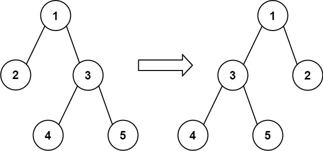

## 翻转二叉树以匹配先序遍历

给你一棵二叉树的根节点 root ，树中有 n 个节点，每个节点都有一个不同于其他节点且处于 1 到 n 之间的值。

另给你一个由 n 个值组成的行程序列 voyage ，表示 预期 的二叉树 先序遍历 结果。

通过交换节点的左右子树，可以 翻转 该二叉树中的任意节点。例，翻转节点 1 的效果如下：


请翻转 最少 的树中节点，使二叉树的 先序遍历 与预期的遍历行程 voyage 相匹配 。

如果可以，则返回 翻转的 所有节点的值的列表。你可以按任何顺序返回答案。如果不能，则返回列表 [-1]。

```
use std::cell::RefCell;
use std::rc::Rc;

impl Solution {
    /// 贪心策略：先序遍历时，若左子节点值不匹配 voyage 的下一个值，
    /// 但右子节点匹配，则翻转当前节点。这是唯一且最少的翻转方案。
    pub fn flip_match_voyage(root: Option<Rc<RefCell<TreeNode>>>, voyage: Vec<i32>) -> Vec<i32> {
        let mut ans = Vec::new();
        let mut i = 0;

        fn dfs(
            node: &Option<Rc<RefCell<TreeNode>>>,
            v: &[i32],
            i: &mut usize,
            ans: &mut Vec<i32>,
        ) -> bool {
            // 空节点直接返回成功
            let Some(n) = node else { return true };
            let n = n.borrow();

            // 值不匹配 -> 不可能
            if n.val != v[*i] { return false; }
            *i += 1;

            // 检查是否需要翻转：左子存在且值不匹配，同时右子匹配
            let flip = n.left.is_some() && *i < v.len()
                && n.left.as_ref().unwrap().borrow().val != v[*i]
                && n.right.is_some() && *i < v.len()
                && n.right.as_ref().unwrap().borrow().val == v[*i];

            // 按翻转后的顺序递归
            let (first, second) = if flip {
                ans.push(n.val);
                (&n.right, &n.left)
            } else {
                (&n.left, &n.right)
            };

            dfs(first, v, i, ans) && dfs(second, v, i, ans)
        }

        if !dfs(&root, &voyage, &mut i, &mut ans) || i != voyage.len() {
            vec![-1]
        } else {
            ans
        }
    }
}
```
