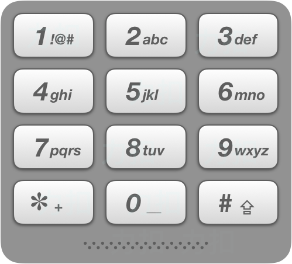

## T9键盘

在老式手机上，用户通过数字键盘输入，手机将提供与这些数字相匹配的单词列表。每个数字映射到0至4个字母。给定一个数字序列，实现一个算法来返回匹配单词的列表。你会得到一张含有有效单词的列表。映射如下图所示：



```
impl Solution {
    pub fn get_valid_t9_words(num: String, words: Vec<String>) -> Vec<String> {
        // 每个字母 'a'..'z' 映射到的数字键
        const KEY_MAP: &[u8; 26] = b"22233344455566677778889999";
        let num = num.as_bytes();

        words
            .into_iter()
            // 长度不同必然不匹配，先过滤掉
            .filter(|w| w.len() == num.len())
            // 逐字符比对：字符串的每个字母映射后的数字须与 num 完全一致
            .filter(|w| {
                w.bytes()
                    .map(|c| KEY_MAP[(c - b'a') as usize])
                    .eq(num.iter().copied())
            })
            .collect()
    }
}
```
