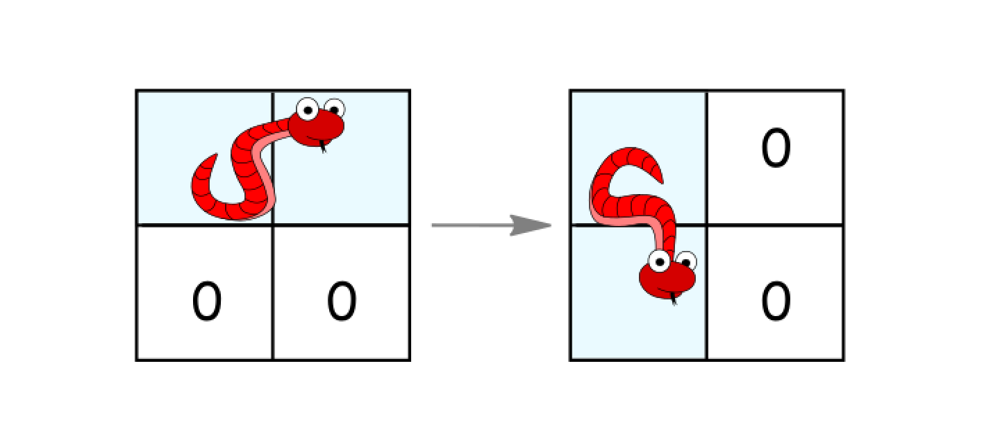

## 穿过迷宫的最少移动次数

你还记得那条风靡全球的贪吃蛇吗？

我们在一个 n*n 的网格上构建了新的迷宫地图，蛇的长度为 2，也就是说它会占去两个单元格。蛇会从左上角（(0, 0) 和 (0, 1)）开始移动。我们用 0 表示空单元格，用 1 表示障碍物。蛇需要移动到迷宫的右下角（(n-1, n-2) 和 (n-1, n-1)）。

每次移动，蛇可以这样走：

· 如果没有障碍，则向右移动一个单元格。并仍然保持身体的水平／竖直状态。
· 如果没有障碍，则向下移动一个单元格。并仍然保持身体的水平／竖直状态。
· 如果它处于水平状态并且其下面的两个单元都是空的，就顺时针旋转 90 度。蛇从（(r, c)、(r, c+1)）移动到 （(r, c)、(r+1, c)）。


· 如果它处于竖直状态并且其右面的两个单元都是空的，就逆时针旋转 90 度。蛇从（(r, c)、(r+1, c)）移动到（(r, c)、(r, c+1)）。


返回蛇抵达目的地所需的最少移动次数。

如果无法到达目的地，请返回 -1。


```
use std::collections::VecDeque;

impl Solution {
    pub fn minimum_moves(grid: Vec<Vec<i32>>) -> i32 {
        let n = grid.len();

        // 蛇的状态用 (行, 列, 朝向) 表示：
        //   朝向 1 = 水平，占 (r, c) 和 (r, c+1)
        //   朝向 2 = 竖直，占 (r, c) 和 (r+1, c)
        // 这里用 (r, c) 表示蛇头所在（即两个格子中左上/上方那个）位置。
        let mut visited = vec![vec![0u8; n]; n];

        let mut queue = VecDeque::new();
        queue.push_back((0usize, 0usize, 1u8));
        visited[0][0] |= 1; // 标记水平朝向已访问

        let mut steps = 0;

        while !queue.is_empty() {
            // 逐层 BFS，每层代表一次移动
            for _ in 0..queue.len() {
                let (r, c, dir) = queue.pop_front().unwrap();

                // 到达目标：水平状态且位于 (n-1, n-2)
                if dir == 1 && r == n - 1 && c == n - 2 {
                    return steps;
                }

                // 根据当前朝向尝试各种移动，生成新状态
                let mut push = |nr: usize, nc: usize, nd: u8, visited: &mut Vec<Vec<u8>>, queue: &mut VecDeque<_>| {
                    if visited[nr][nc] & nd == 0 {
                        visited[nr][nc] |= nd;
                        queue.push_back((nr, nc, nd));
                    }
                };

                if dir == 1 {
                    // 水平状态：占 (r, c) 和 (r, c+1)

                    // 向右平移一格
                    if c + 2 < n && grid[r][c + 2] == 0 {
                        push(r, c + 1, 1, &mut visited, &mut queue);
                    }

                    // 向下平移一格（下面两个格子必须为空）
                    if r + 1 < n && grid[r + 1][c] == 0 && grid[r + 1][c + 1] == 0 {
                        // 顺时针旋转成竖直状态，占 (r, c) 和 (r+1, c)
                        push(r, c, 2, &mut visited, &mut queue);
                        // 保持水平向下平移
                        push(r + 1, c, 1, &mut visited, &mut queue);
                    }
                } else {
                    // 竖直状态：占 (r, c) 和 (r+1, c)

                    // 向下平移一格
                    if r + 2 < n && grid[r + 2][c] == 0 {
                        push(r + 1, c, 2, &mut visited, &mut queue);
                    }

                    // 向右平移一格（右边两个格子必须为空）
                    if c + 1 < n && grid[r][c + 1] == 0 && grid[r + 1][c + 1] == 0 {
                        // 逆时针旋转成水平状态，占 (r, c) 和 (r, c+1)
                        push(r, c, 1, &mut visited, &mut queue);
                        // 保持竖直向右平移
                        push(r, c + 1, 2, &mut visited, &mut queue);
                    }
                }
            }
            steps += 1;
        }

        -1
    }
}
```
