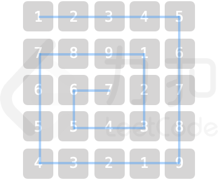

## 乐团站位

某乐团的演出场地可视作 num * num 的二维矩阵 grid（左上角坐标为 [0,0])，每个位置站有一位成员。乐团共有 9 种乐器，乐器编号为 1~9，每位成员持有 1 个乐器。

为保证声乐混合效果，成员站位规则为：自 grid 左上角开始顺时针螺旋形向内循环以 1，2，...，9 循环重复排列。例如当 num = 5 时，站位如图所示


请返回位于场地坐标 [Xpos,Ypos] 的成员所持乐器编号。


```
impl Solution {
    pub fn orchestra_layout(num: i32, x_pos: i32, y_pos: i32) -> i32 {
        // 统一提升到 i64，避免中间计算溢出
        let (n, x, y) = (num as i64, x_pos as i64, y_pos as i64);

        // 当前位置到四条边的最小距离，即所在层数（从 0 开始）
        let circle = x.min(y).min(n - 1 - x).min(n - 1 - y);
        // 当前层的边长
        let side = n - 2 * circle;

        // 在当前层上（顺时针从左上角开始）的偏移量
        let offset = if x == circle {
            // 上边：从左到右
            y - circle
        } else if y == n - 1 - circle {
            // 右边：从上到下
            side - 1 + (x - circle)
        } else if x == n - 1 - circle {
            // 下边：从右到左
            2 * (side - 1) + (n - 1 - circle - y)
        } else {
            // 左边：从下到上
            3 * (side - 1) + (n - 1 - circle - x)
        };

        // 前面 circle 层的格子总数：
        // sum_{k=0}^{circle-1} 4*(n - 2k - 1) = 4 * circle * (n - circle)
        let base = 4 * circle * (n - circle);

        // 乐器编号从 1 开始，每 9 个循环
        ((base + offset) % 9) as i32 + 1
    }
}
```
