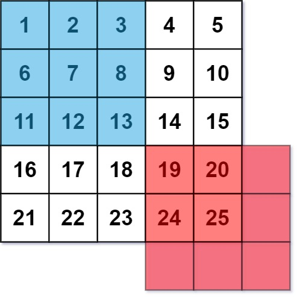

## 图片平滑器

图像平滑器 是大小为 3 x 3 的过滤器，用于对图像的每个单元格平滑处理，平滑处理后单元格的值为该单元格的平均灰度。

每个单元格的  平均灰度 定义为：该单元格自身及其周围的 8 个单元格的平均值，结果需向下取整。（即，需要计算蓝色平滑器中 9 个单元格的平均值）。

如果一个单元格周围存在单元格缺失的情况，则计算平均灰度时不考虑缺失的单元格（即，需要计算红色平滑器中 4 个单元格的平均值）。

给你一个表示图像灰度的 m x n 整数矩阵 img ，返回对图像的每个单元格平滑处理后的图像 。

```
impl Solution {
    pub fn image_smoother(img: Vec<Vec<i32>>) -> Vec<Vec<i32>> {
        let m = img.len();
        let n = img[0].len();
        let mut ret = vec![vec![0; n]; m];

        for i in 0..m {
            // 用 i32 避免越界减法，直接限制上下边界
            let i_start = i.saturating_sub(1);
            let i_end = (i + 1).min(m - 1);

            for j in 0..n {
                let j_start = j.saturating_sub(1);
                let j_end = (j + 1).min(n - 1);

                // 遍历 3x3 邻域内实际存在的单元格，累加求和与计数
                let mut sum = 0;
                let mut count = 0;
                for x in i_start..=i_end {
                    for y in j_start..=j_end {
                        sum += img[x][y];
                        count += 1;
                    }
                }
                ret[i][j] = sum / count;
            }
        }

        ret
    }
}
```
