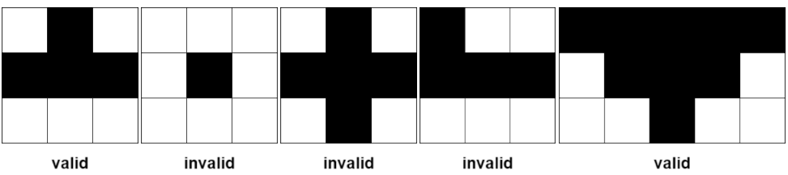

## 统计农场中肥沃金字塔的数目

有一个 矩形网格 状的农场，划分为 m 行 n 列的单元格。每个格子要么是 肥沃的 （用 1 表示），要么是 贫瘠 的（用 0 表示）。网格图以外的所有与格子都视为贫瘠的。

农场中的 金字塔 区域定义如下：

1. 区域内格子数目 大于 1 且所有格子都是 肥沃的 。
2. 金字塔 顶端 是这个金字塔 最上方 的格子。金字塔的高度是它所覆盖的行数。令 (r, c) 为金字塔的顶端且高度为 h ，那么金字塔区域内包含的任一格子 (i, j) 需满足 r <= i <= r + h - 1 且 c - (i - r) <= j <= c + (i - r) 。

一个 倒金字塔 类似定义如下：

1. 区域内格子数目 大于 1 且所有格子都是 肥沃的 。
2. 倒金字塔的 顶端 是这个倒金字塔 最下方 的格子。倒金字塔的高度是它所覆盖的行数。令 (r, c) 为金字塔的顶端且高度为 h ，那么金字塔区域内包含的任一格子 (i, j) 需满足 r - h + 1 <= i <= r 且 c - (r - i) <= j <= c + (r - i) 。

下图展示了部分符合定义和不符合定义的金字塔区域。黑色区域表示肥沃的格子。

给你一个下标从 0 开始且大小为 m x n 的二进制矩阵 grid ，它表示农场，请你返回 grid 中金字塔和倒金字塔的 总数目 。


```
impl Solution {
    /// 统计金字塔 + 倒金字塔总数。
    ///
    /// 核心递推（以正金字塔为例）：
    ///   设 f[i][j] = 以 (i,j) 为顶点、向下的最大金字塔高度。
    ///   以 (i,j) 为顶点的金字塔由下一行相邻三格 (i+1, j-1/j/j+1) 的金字塔"叠加"而来，
    ///   故 f[i][j] = min(f[i+1][j-1], f[i+1][j], f[i+1][j+1]) + 1。
    ///   高度 1..=f[i][j] 的金字塔均成立，故直接累加 f[i][j]。
    ///
    /// 约定：
    ///   f = -1 表示该格贫瘠（0），参与 min 时自动"传染"，无需额外边界判断。
    ///   f = 0  表示该格肥沃但处在无法再扩展的边界，贡献 0。
    ///
    /// 倒金字塔即上下翻转后的正金字塔，复用同一数组原地重算。
    /// 时间复杂度 O(m*n)，空间复杂度 O(m*n)。
    pub fn count_pyramids(grid: Vec<Vec<i32>>) -> i32 {
        let m = grid.len();
        let n = grid[0].len();
        let mut f = vec![vec![0i32; n]; m];
        let mut ans = 0;

        // 正金字塔：自底向上递推
        for i in (0..m).rev() {
            for j in 0..n {
                if grid[i][j] == 0 {
                    f[i][j] = -1;
                } else if i == m - 1 || j == 0 || j == n - 1 {
                    f[i][j] = 0;
                } else {
                    f[i][j] = f[i + 1][j - 1].min(f[i + 1][j]).min(f[i + 1][j + 1]) + 1;
                    ans += f[i][j];
                }
            }
        }

        // 倒金字塔：自顶向下递推，等价于把网格上下翻转后求正金字塔
        for i in 0..m {
            for j in 0..n {
                if grid[i][j] == 0 {
                    f[i][j] = -1;
                } else if i == 0 || j == 0 || j == n - 1 {
                    f[i][j] = 0;
                } else {
                    f[i][j] = f[i - 1][j - 1].min(f[i - 1][j]).min(f[i - 1][j + 1]) + 1;
                    ans += f[i][j];
                }
            }
        }

        ans
    }
}
```
